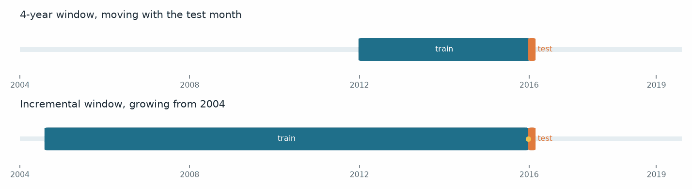
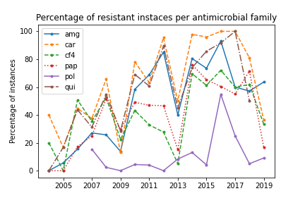
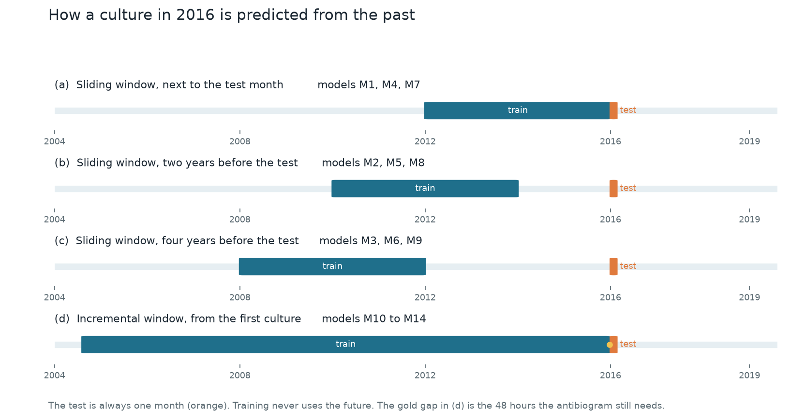
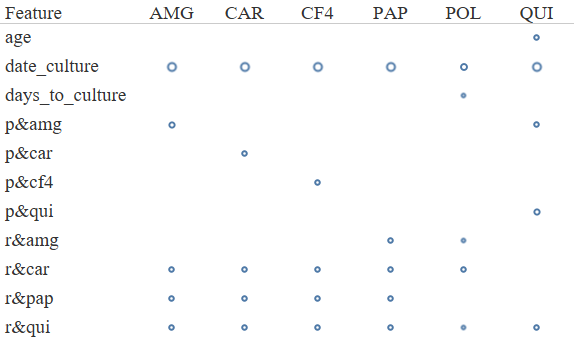
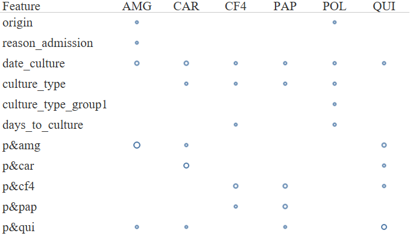

# Antimicrobial resistance prediction in the ICU

[](https://doi.org/10.9781/ijimai.2021.02.012)
[](https://www.python.org/)
[](LICENSE)

Antimicrobial resistance arises when a microorganism no longer responds to a drug that previously inhibited it. In an intensive care unit the consequences are immediate: patients are already critically ill, and the usual laboratory test, the antibiogram, takes about 48 hours to report whether the isolated bacterium is resistant or susceptible. During that interval the antibiotic treatment has to be chosen without the laboratory result.

The objective of this work is to predict, for a culture of *Pseudomonas aeruginosa*, whether the bacterium will be resistant or susceptible to a given antibiotic family, using only information that is already available before the antibiogram result. *Pseudomonas aeruginosa* was selected because it is frequent in the ICU, it causes severe infection, and it readily develops resistance to several drugs.

To do that, the study uses electronic health records (EHR) that the hospital already stores, together with the results of earlier antibiograms. The approach does not require whole-genome sequencing. The same records can therefore be used in other ICUs that collect cultures, admission data and susceptibility results.

The cohort of EHR data comes from the ICU of Hospital Universitario de Fuenlabrada (Madrid, Spain). It covers 3,346 patients and 3,812 admissions, from July 2004 to May 2019. Over that period 43,658 cultures were collected, from which this study retains the 764 cultures in which *Pseudomonas aeruginosa* was isolated. Some patients have more than one admission, which is why the number of admissions is larger than the number of patients.

Resistance is predicted separately for each antibiotic family. Six binary classifiers are trained, one per family, because a culture may be resistant to one family and susceptible to another, and because each classifier can then be examined on its own. The families considered in the study are the following.

| Code | Antibiotic family |
| --- | --- |
| AMG | Aminoglycosides |
| CAR | Carbapenems |
| CF4 | 4th generation cephalosporins |
| PAP | Extended-spectrum penicillins |
| POL | Polymyxins |
| QUI | Quinolones |

The prediction is repeated month by month. Two constructions of the training set are compared. In a **sliding window**, training uses a fixed period of four years placed before the month being predicted. In an **incremental window**, training starts at the beginning of the cohort and grows by one month at every step, always stopping before the month being predicted. The animation below shows these two constructions. The orange mark is the test month.

**Training and test windows considered in the study: sliding and incremental**

<p align="center">
  
</p>

This repository contains the code that corresponds to the published experiment.

> Hernández-Carnerero, À., Sànchez-Marrè, M., Mora-Jiménez, I., Soguero-Ruiz, C., Martínez-Agüero, S., & Álvarez-Rodríguez, J. (2021). *Antimicrobial Resistance Prediction in Intensive Care Unit for Pseudomonas aeruginosa using Temporal Data-Driven Models.* International Journal of Interactive Multimedia and Artificial Intelligence. [https://doi.org/10.9781/ijimai.2021.02.012](https://doi.org/10.9781/ijimai.2021.02.012)

## Change of resistance over time

The proportion of resistant cultures changes over the 15 years of the cohort. In the earlier years, susceptible results are the majority for most families. In the later years, resistant results become more frequent. The series also falls in 2013, when the ICU information system was replaced and fewer antibiograms were recorded. Polymyxins remain an exception: resistant results stay uncommon. Carbapenems move in the opposite direction and are resistant in nearly every culture by the end of the period.

<p align="center">
  
</p>

A classifier trained on the early years therefore learns a period in which susceptibility predominates. Applied unchanged to the later years, it continues to predict susceptibility and misses a large part of the resistant cultures. The chronological order of the cultures has to be preserved for a second, practical reason. When the model is used on a new culture, antibiograms that have not yet been collected do not exist. A training set that contained those future cultures would use information unavailable at prediction time. For that reason, cultures are sorted by the date of the culture, and a culture is predicted only from cultures collected before it.

The test set is always one calendar month. The first test month is January 2016, and the window then advances one month at a time, without overlap, until the end of the cohort. The training set that precedes each test month is built in one of the two ways shown above. The sliding window is also placed at three distances from the test month, so that the effect of predicting from an older period can be measured.

<p align="center">
  
</p>

In panel (a) the four-year training window ends just before the test month. In panels (b) and (c) the same four-year window is moved back by two and four years. In panel (d) training contains every culture from the start of the cohort up to the test month, and it grows as the test month advances. The correspondence with models M1–M14 is given in the table of the next section: the same window is repeated with different sets of past-resistance features.

Two further restrictions keep the experiment close to clinical use. A patient who has a culture in the test month is removed from training, so the classifier is not evaluated on a patient already seen. When the training window ends immediately before the test window, cultures from the final 48 hours are excluded as well, because the antibiogram result of those cultures is not yet available.

The figure originally published with the paper is kept in [`assets/figures/paper_windows.png`](assets/figures/paper_windows.png). It shows the same placement of the training and test intervals.

## Features derived from past antibiograms

Each culture is described by demographic variables, by variables of the ICU admission, and by variables of the culture itself, including its date. In addition, the study proposes two groups of features that summarize antibiograms already reported before the culture being predicted.

Both groups use cultures of *Pseudomonas aeruginosa* collected between 21 days and 48 hours before the current culture. The 48-hour limit is the time required for an antibiogram result to become available. The 21-day limit is the period during which, from a clinical standpoint, a resistant result is still treated as current.

A past culture that was resistant contributes a weight that decreases as the number of elapsed days increases. A past culture that was susceptible contributes zero. With the decay parameter fixed at $\lambda = 0.095$, a resistant culture $c_k$ collected on day $d_k$ contributes the following amount to the culture $c$ collected on day $d$:

$$e^{-\lambda (d - d_k)}.$$

The first group describes the patient under study. For antibiotic family $a_i$, the feature is the largest contribution among the past cultures of that same patient. In the paper this feature is written `p&a_i`:

$$p_{a_i} = \max_k \mathrm{NEF}(c_k, c).$$

The second group describes the other patients who were in the intensive care unit. For each of those patients the largest contribution is taken, and the values are then added. In the paper this feature is written `r&a_i`:

$$r_{a_i} = \sum_{j \neq p} \max_k \mathrm{NEF}(c_{j,k}, c).$$

Six features of each group are computed, one per antibiotic family. If the time window contains no test of that family, the feature is left missing and is later replaced by zero. The interpretation used in the study is that the absence of a test is an absence of evidence that a bacterium resistant to that family was present.

The relevance of these variables depends on how it is measured. Mutual information is computed for each variable separately. It assigns the highest score to the date of the culture for every family, and it also assigns high scores to the ICU-wide features `r&a_i`. Random-forest importance is computed from an ensemble that uses all of the variables at once. Under that measure, the patient's own recent result for the family being predicted, `p&a_i`, is the highest-ranked variable for five of the six families. The date of the culture remains informative, but it mainly reflects the increase in the proportion of resistant cultures. Used as a predictor, it biases the classifier toward the class that predominates in the years being predicted, and the accuracy on susceptible cultures falls. Polymyxins are the exception: few cultures are resistant, and the culture date remains the most important variable.

<p align="center">
  
</p>

Mutual information, computed one variable at a time. The area of each marker is the score.

<p align="center">
  
</p>

Random-forest importance, computed with all variables used jointly. The patient's own past result leads for every family except polymyxins.

## The fourteen models

Logistic regression is the baseline classifier. Random forest is the second classifier. Before logistic regression, the predictors are standardized with the mean and variance of the training window. The class distribution is left as it is observed: the published experiments do not oversample the minority class, because the change in that proportion is part of the phenomenon under study.

| Models | Training window | Past-resistance features |
| --- | --- | --- |
| M1, M2, M3 | Sliding, 4 years, placed 0, 2 and 4 years before the test | none |
| M4, M5, M6 | Sliding, 4 years, placed 0, 2 and 4 years before the test | ICU patients only (`r&`) |
| M7, M8, M9 | Sliding, 4 years, placed 0, 2 and 4 years before the test | the patient and the ICU (`p&` and `r&`) |
| M10, M11, M12 | Incremental, from the first culture | none, ICU only, or both |
| M13, M14 | Incremental, with a weight on each training culture | ICU only, or both |

Every model is trained twice, once with the culture date and once without it.

For M13 and M14 the training cultures do not all contribute equally. A culture close to the test month receives a larger weight than a culture from the early years. If $d_l$ is the date of the last culture in the training window and $d_c$ is the date of the culture being weighted, its weight is

$$w(c) = e^{-\lambda (d_l - d_c)}.$$

This $\lambda$ is a second parameter. It is distinct from the value $0.095$ used to build `p&` and `r&`. It is chosen, for each experiment, from

$$\{0,\ 10^{-5},\ 10^{-4},\ 10^{-3},\ 10^{-2},\ 0.1,\ 1\}$$

as the value that obtains the best figures of merit. When $\lambda = 0$, the exponent is zero for every culture, so every training culture receives the same weight, $w(c) = 1$. When $\lambda$ is large, only cultures collected shortly before the test month keep a weight close to 1, and the older cultures are almost ignored. The selected values are listed in [`results/published_lambda.csv`](results/published_lambda.csv).

Performance is summarized by three figures of merit. They are computed from counts accumulated over all test months, rather than by averaging the accuracy of each month. A month that contains many cultures then contributes more than a month that contains few. Let $N_s$ and $N_r$ be the number of susceptible and resistant cultures in the accumulated test set, and let $S_s$ and $S_r$ be the number of those cultures that are correctly classified. Total, resistant and susceptible accuracy are

$$A_{\mathrm{Tot}} = \frac{S_s + S_r}{N_s + N_r}, \qquad A_{\mathrm{Rst}} = \frac{S_r}{N_r}, \qquad A_{\mathrm{Scb}} = \frac{S_s}{N_s}.$$

## Published results

The table below reports the best result obtained with the weighted incremental window for each family, in the order total / resistant / susceptible accuracy. The complete grid is in [`results/published_accuracy.csv`](results/published_accuracy.csv).

| Family | Model | Classifier | Culture date | Total / resistant / susceptible accuracy |
| --- | --- | --- | --- | --- |
| AMG | M14 | Random forest | excluded | **79.55 / 75.76 / 90.91** |
| CAR | M13 | Logistic regression | either | **94.32 / 100 / 16.67** |
| CF4 | M14 | Random forest | excluded | **60.67 / 58.62 / 64.52** |
| PAP | M14 | Logistic regression | excluded | **71.91 / 69.81 / 75.00** |
| POL | M13 | Logistic regression | included | **72.41 / 60.00 / 78.95** |
| QUI | M14 | Random forest | excluded | **83.02 / 83.33 / 80.00** |

The total accuracy for carbapenems is high because, in the test years, almost every culture of that family is resistant. The susceptible accuracy shows the cost of that imbalance. Polymyxins have very few resistant cultures. For that family, the best result in the paper is a sliding window placed immediately before the test month, with logistic regression, without the culture date and without the past-resistance features: 74.71 / 63.33 / 80.70.

A further experiment predicts each family from a single variable. The patient's own past result, `p&a_i`, is already sufficient for a relatively high accuracy in several families. The culture date on its own concentrates the logistic-regression predictions on the majority class of the test period. Both experiments are reported in [`results/published_single_feature.csv`](results/published_single_feature.csv).

## Running the code

```bash
pip install -e ".[dev]"
python -m amr_icu --synthetic
```

The default command trains logistic regression and a random forest for models M7, M12 and M14 on an invented cohort, for the aminoglycoside family. It takes a few minutes. The printed accuracies only confirm that the pipeline runs. They are not comparable to the published table.

```bash
python -m amr_icu --synthetic --family all --models all --date-culture both
python -m amr_icu --data path/to/cohort.csv --family qui --models M14 --methods rf
python -m amr_icu --synthetic --importance
pytest
```

A cohort file uses the columns described in [`data/README.md`](data/README.md). Each row is one culture. A resistance cell contains `r`, `s`, or is left empty when that family was not tested. The package derives the calendar variables and the past-resistance features.

```text
src/amr_icu/
  features.py      p& and r&, from the negative exponential
  preprocess.py    stays of at least 48 hours, integer codes, correlated dates removed
  windows.py       monthly test, sliding and incremental training, patient exclusion
  models.py        logistic regression, with standardization, and random forest
  metrics.py       total, resistant and susceptible accuracy, accumulated over months
  experiment.py    models M1–M14 and the search over the weight decay
  synthetic.py     invented cohort used to run the code
```

The experiments were originally run from a collection of notebooks, duplicated for each antibiotic family. Some of those notebooks also tried SMOTE and a long short-term memory network. Those trials are outside the published comparison, and they are not included here. The implementation follows the definitions in the paper: a margin of 48 hours, a feature decay of $\lambda = 0.095$, and test months from January 2016. It does not reproduce the notebooks line by line. The notebooks advanced by a month index counted from the first culture and, in some revisions, applied an oversampling step that the paper does not use.

## Data

The hospital extract is not part of this repository. The file is anonymized, but it still contains dates, age, sex, the department of origin and the reason for admission. Combined, those fields can re-identify a stay, and the hospital requested that the data remain private. The file [`data/synthetic/cohort.csv`](data/synthetic/cohort.csv) has the same columns and contains no patient from the study. Accuracies computed from it cannot be compared with the published results.

## Citation

```bibtex
@article{hernandez2021amr,
  title   = {Antimicrobial Resistance Prediction in Intensive Care Unit for {Pseudomonas} aeruginosa using Temporal Data-Driven Models},
  author  = {Hern{\'a}ndez-Carnerero, {\`A}lvar and S{\`a}nchez-Marr{\`e}, Miquel and Mora-Jim{\'e}nez, Inmaculada and Soguero-Ruiz, Cristina and Mart{\'\i}nez-Ag{\"u}ero, Sergio and {\'A}lvarez-Rodr{\'\i}guez, Joaqu{\'\i}n},
  journal = {International Journal of Interactive Multimedia and Artificial Intelligence},
  year    = {2021},
  doi     = {10.9781/ijimai.2021.02.012}
}
```

A machine-readable citation is in [`CITATION.cff`](CITATION.cff). The figures taken from the study are in `assets/figures/` and are reproduced with the paper.
